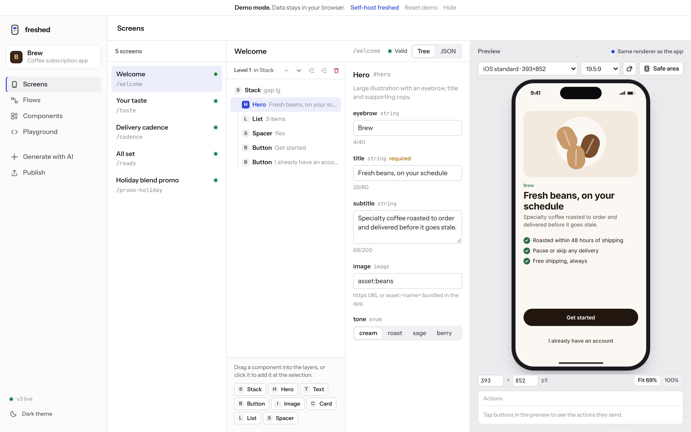
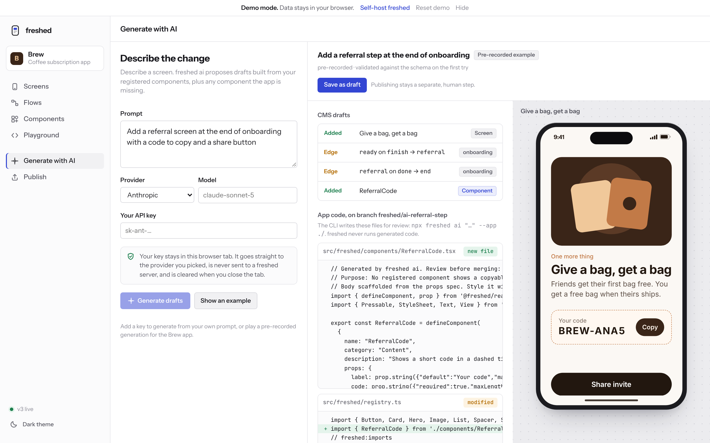
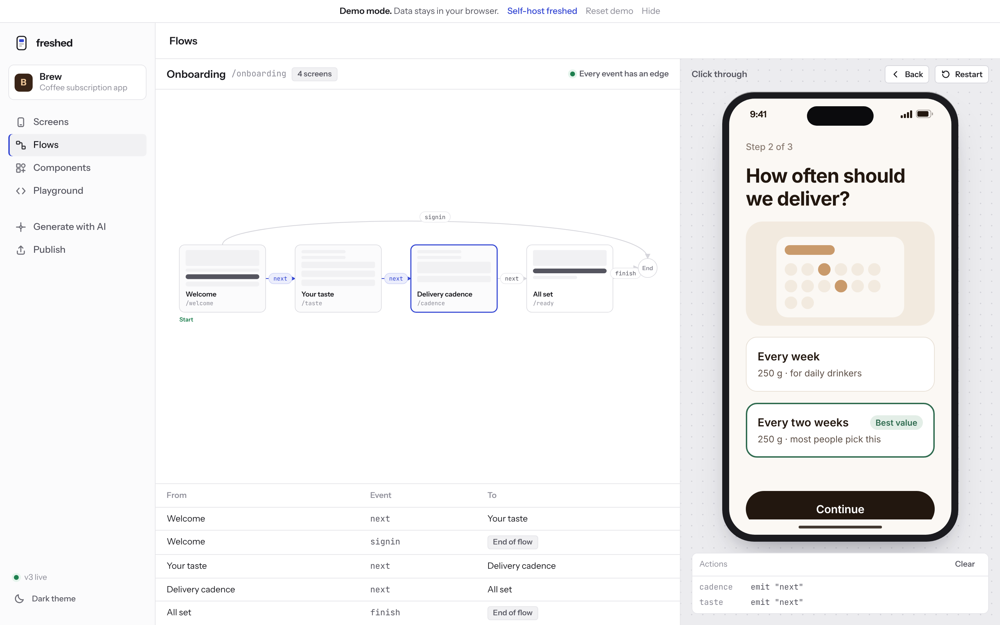
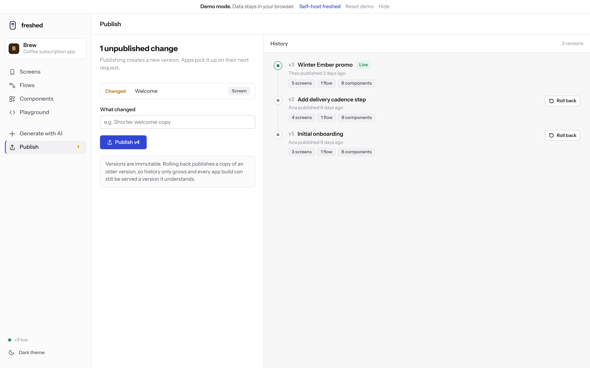
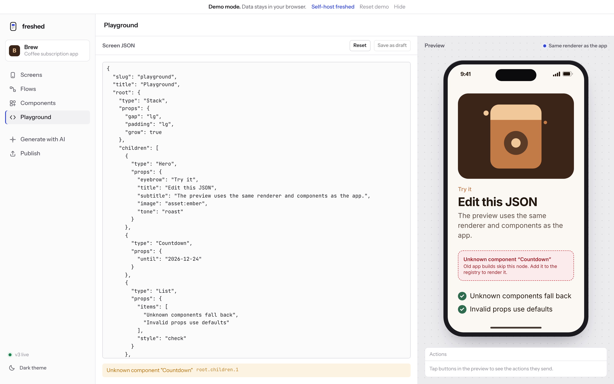
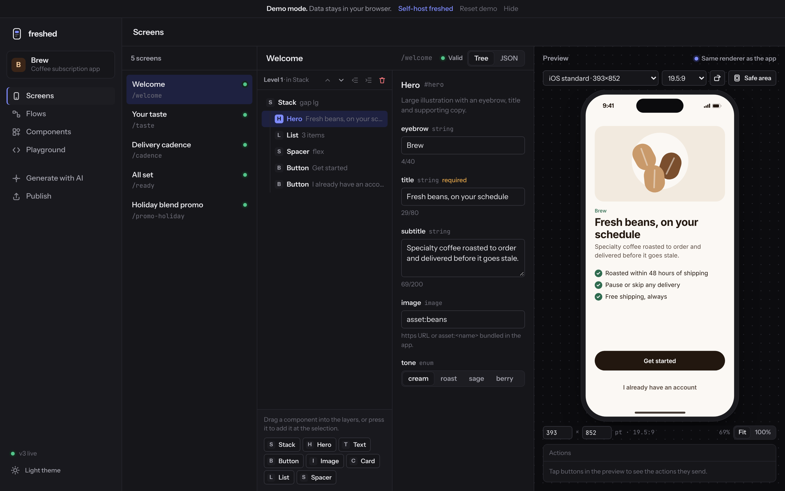

# freshed

**Ship new screens to your Expo app without a store release.**

A small, self-hosted CMS for server-driven UI in Expo and React Native, backed by Postgres.
Register the components your app already ships, compose screens and flows in a visual Studio, and
publish versioned JSON your app renders at runtime.

**[Live demo →](https://mauriciomsouza.github.io/freshed/)** Runs in your browser with a fictional
coffee app. No signup, no server.

[](https://github.com/mauriciomsouza/freshed/actions/workflows/ci.yml)
[](LICENSE)



## Why

Every copy tweak, new onboarding step or seasonal promo in a mobile app needs a build, a store
review and users who update. Server-driven UI fixes that, but most options are enterprise
platforms, closed source, or a renderer without the parts you need to run it safely: a component
registry, previews, versioning and rollback. freshed is those parts, small enough to read in an
afternoon.

## How it works

```
 ┌──────────────┐  drafts   ┌──────────────────────┐  publish   ┌──────────────────────┐
 │    Studio    │ ────────► │   freshed server     │ ─────────► │ versions (immutable) │
 │ edit, preview│           │   Hono + Postgres    │            │ v1  v2  v3 ... live  │
 └──────────────┘           └──────────────────────┘            └──────────┬───────────┘
        ▲                                                                  │ GET /v1/flows/onboarding
        │ same renderer, same components (react-native-web)                │ ETag / 304, protocol-aware
        │                                                                  ▼
 ┌──────┴───────────────────────────────────────────────────────────────────────────────┐
 │  Your Expo app: <FreshedProvider registry={[Hero, Card, Button...]}>                   │
 │  JSON → registered components. Unknown ones fall back. Last good copy cached offline. │
 └───────────────────────────────────────────────────────────────────────────────────────┘
```

## Data only, never code

Screens reference components that **already exist in your app bundle**. freshed never sends,
evaluates or downloads code. Behaviour is declarative (`navigate`, `emit`, `openUrl`, `share`...)
and your app implements it. Old app builds keep working: every request carries a protocol version
and the server only sends what that build can read. Unknown components and invalid props degrade
gracefully instead of crashing. Details in [SDUI_PROTOCOL.md](docs/specs/SDUI_PROTOCOL.md).

## Quick start (5 minutes)

**1. Run the server and Postgres**

```bash
git clone https://github.com/mauriciomsouza/freshed && cd freshed
cp .env.example .env        # set FRESHED_ADMIN_KEY and FRESHED_PUBLIC_KEY
docker compose up           # API on http://localhost:8787, seeded with the Brew example
```

No Docker? `pnpm install && pnpm dev:server` runs the same server on an embedded Postgres
(PGlite), seeded with Brew and with development keys printed on start.

**2. Open the Studio**

```bash
pnpm install
VITE_FRESHED_API=http://localhost:8787 VITE_FRESHED_ADMIN_KEY=<your admin key> pnpm dev
# or just `pnpm dev` for demo mode
```

**3. Add the renderer to your app**

```bash
npm i @freshed/react-native
```

```tsx
import AsyncStorage from '@react-native-async-storage/async-storage'
import { createClient, FreshedFlow, FreshedProvider } from '@freshed/react-native'
import { router } from 'expo-router'
import { Linking } from 'react-native'
import { components } from './freshed/registry'

const client = createClient({
  baseUrl: 'https://cms.example.com',
  apiKey: process.env.EXPO_PUBLIC_FRESHED_KEY!, // read-only public key, safe to ship
  storage: AsyncStorage, // last good copy survives restarts and outages
})

export default function App() {
  return (
    <FreshedProvider
      client={client}
      registry={components}
      actions={{ openUrl: ({ url }) => Linking.openURL(url) }}
    >
      <FreshedFlow slug="onboarding" onEnd={() => router.replace('/home')} />
    </FreshedProvider>
  )
}
```

## Register components

A component is a typed props spec plus your own implementation. Props are inferred from the spec,
and the same spec is what the CMS stores and validates against.

```tsx
import { defineComponent, prop } from '@freshed/react-native'
import { Pressable, Text } from 'react-native'

export const Button = defineComponent(
  {
    name: 'Button',
    description: 'Primary, secondary or text button that triggers an action.',
    props: {
      label: prop.string({ required: true, maxLength: 32 }),
      variant: prop.enum(['primary', 'secondary', 'ghost'], { default: 'primary' }),
      action: prop.action({ required: true }),
    },
  },
  // label: string, variant: 'primary' | 'secondary' | 'ghost', action: () => void
  ({ label, variant, action }) => (
    <Pressable onPress={action} accessibilityRole="button" style={styles[variant]}>
      <Text>{label}</Text>
    </Pressable>
  ),
)
```

Render a single screen anywhere with `<FreshedScreen slug="promo-holiday" />`, or drive a flow
yourself with `useFlow('onboarding')`.

## freshed ai

One prompt creates the draft screens in the CMS **and** the matching code in your app repo, wired
together. Bring your own key (Anthropic first-class, any OpenAI-compatible API works too).

```bash
export FRESHED_AI_KEY=sk-ant-...
npx freshed ai "Add a referral screen after onboarding with a code to copy and a share button" \
  --app ./ --server https://cms.example.com
```

- Draft screens and flow edges built from your registered components, validated against the
  schema (repaired once, or rejected).
- If a component is missing, it is written with `defineComponent` on a new branch
  `freshed/ai-<slug>`, added to your registry, and its props spec is synced to the CMS.
- Never publishes, never touches your default branch, never runs generated code. `--pr` opens a
  draft PR for review.



The same panel is in the Studio. In the demo it calls the provider straight from your browser with
your key, which stays in that tab. More in [AI_CONNECTOR.md](docs/specs/AI_CONNECTOR.md).

## More of the Studio

| Flows: click through the onboarding               | Publish: immutable versions and rollback                    |
| ------------------------------------------------- | ----------------------------------------------------------- |
|  |  |
| **Playground: paste JSON, see fallbacks**         | **Dark theme**                                              |
|  |   |

## Project structure

```
packages/
  schema/          zod schemas, validation, protocol versioning (@freshed/schema)
  react-native/    renderer: pure core + React bindings (@freshed/react-native)
  ai/              freshed ai: providers, generation, codegen, sync (@freshed/ai)
  cli/             npx freshed ai (freshed)
apps/
  server/          Hono + Postgres API, SQL migrations, PGlite tests
  studio/          React + Vite CMS UI, demo mode for GitHub Pages
examples/
  brew/            fictional "Brew" component specs and seed content
  expo-app/        Expo app rendering the Brew onboarding
docs/              plan, stack, protocol and AI specs, design spec, business, launch
```

## Development

```bash
pnpm install
pnpm test          # schema, renderer, ai, cli, server (PGlite), studio
pnpm typecheck && pnpm lint
pnpm --filter @freshed/studio build:pages && node scripts/verify-pages.mjs
```

## How this repo is built

freshed is built by a small team of AI agents with one human owner: Orchestrator, Business, Design,
Dev, QA, Infra, Release and Marketing, each with a written role in [`.claude/agents`](.claude/agents).
The rules every agent follows are in [CLAUDE.md](CLAUDE.md); the most important is that whoever
implements a change does not approve it. Every UI change ships with screenshots the owner reviews.
See [docs/AGENT_TEAM.md](docs/AGENT_TEAM.md).

## Roadmap

- Studio auth and roles (editor, publisher); scheduled and staged publishes
- Form inputs with `submit` collection and validation in the spec
- Analytics hooks and A/B variants as data
- npm releases and a `create-freshed` starter
- Extract component specs from existing app code

Full plan in [docs/PLAN.md](docs/PLAN.md).

## License

[MIT](LICENSE) © Mauricio Souza
